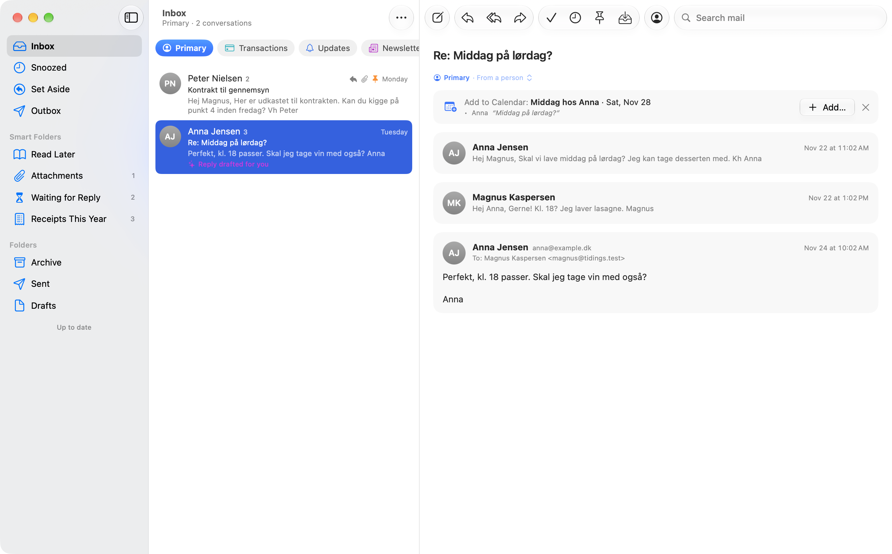
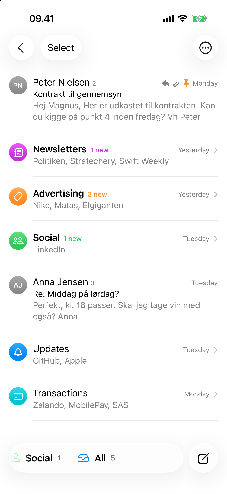
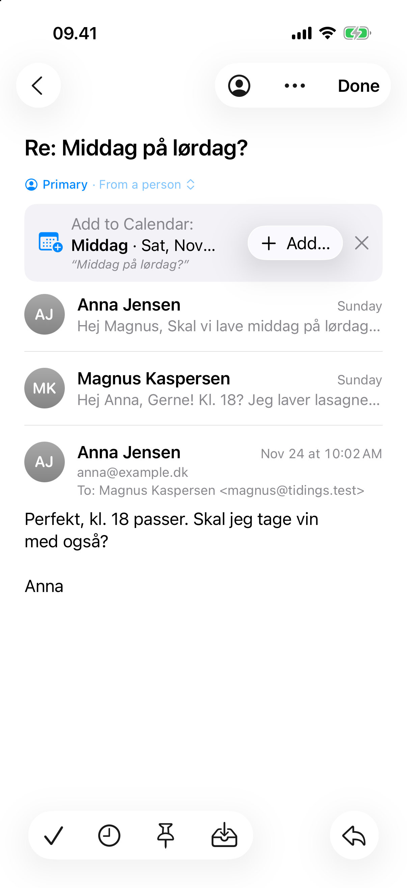
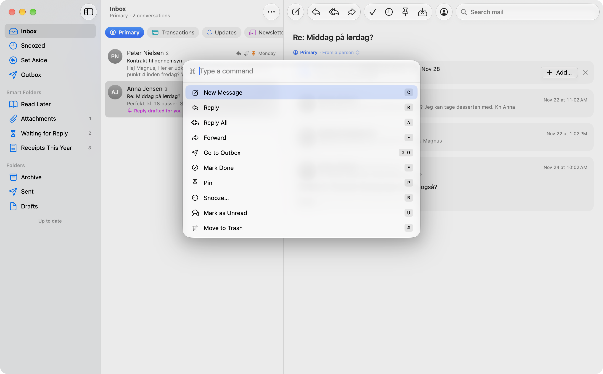

# Tidings

A native, keyboard-first, local-first mail client for Mac and iPhone: Google Inbox–style triage, on-device AI sorting, rules, smart folders and fast search, in pure Apple Liquid Glass. Works with iCloud Mail and any IMAP/SMTP account.



<p align="center">
  
  &nbsp;
  
</p>

## What it does

- **Triage, not filing.** Mark a conversation Done, snooze it, pin it, or set it aside to answer later. Sweep everything you haven't pinned in one go. Every action can be undone.
- **One stream, sorted for you.** Your important mail shows conversation by conversation. Transactions, updates, newsletters, ads and social mail fold into bundles, which can arrive once a day. You can also describe a category in a sentence of your own.
- **On-device AI.** Sorting, calendar suggestions from dates in your mail, one-time codes, conversation summaries and phishing checks run on your Mac or iPhone with Apple's on-device models. Nothing about your mail leaves the device.
- **Rules and smart folders.** Outlook-style rules with a live preview and undoable history. Smart folders are saved searches.
- **Fast search** with Gmail-style operators (`from:`, `has:attachment`, `after:30d`, `account:` …) and Danish and English stemming.
- **Privacy by default.** Tracking pixels and tracking links are stripped. Images stay hidden until you trust the sender. Look-alike domains and mismatched links get a warning.
- **Several accounts.** iCloud (with an app-specific password) and any IMAP/SMTP server, with the servers filled in for common providers. There's a unified Inbox and one per account.
- **Same state everywhere.** Rules, smart folders, Reply Later, snoozes and settings sync between your devices through your private iCloud. Your mail stays with your mail server.
- **Keyboard first.** Every action has a key and lives in the ⌘K palette. On iPhone, everything is a tap, a swipe or a hold.
- In English and Danish.



## Install

**Mac:** download the latest `.dmg` from [Releases](https://github.com/Magniswerfer/tidings-mail/releases/latest). It's signed and notarized and keeps itself up to date (Tidings › Check for Updates…). Needs macOS 26 on Apple silicon.

**iPhone and iPad:** build from source for now (iOS 26).

## Build from source

Needs Xcode 26 and [XcodeGen](https://github.com/yonaskolb/XcodeGen).

```bash
cd App && xcodegen generate && open Tidings.xcodeproj
```

The mail engine is a separate Swift package with its own tests:

```bash
swift test --package-path MailEngine
```

Integration tests and the dev copy of the app use a local Dovecot (IMAP) and Mailpit (SMTP) in Docker, so development never touches a real mailbox:

```bash
MailEngine/TestServer/make-certs.sh && docker compose -f MailEngine/TestServer/compose.yml up -d
```

Releases are built with `scripts/release.sh`: it produces a Developer ID–signed, notarized `.dmg` and a Sparkle update feed.

## Docs

- [Product and technical spec](docs/SPEC.md)
- [Architecture decisions](docs/adr/)
- [iCloud IMAP notes](docs/research/icloud-imap.md)

## License

[AGPL-3.0](LICENSE)
